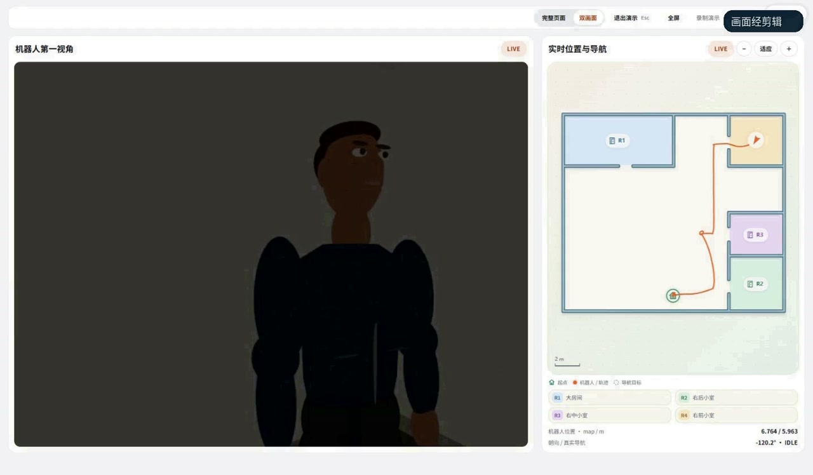
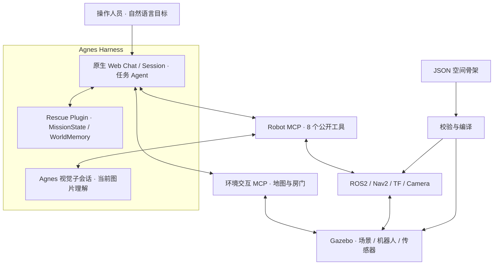

# Agnes Embodied Rescue

**具身救援 · 从指令到行动**

面向室内人员搜寻的具身智能仿真项目。操作人员在 Agnes 原生对话界面给出目标，Agent 结合当前相机画面、地图定位和工具反馈，组织导航、房门交互、人员搜寻与视觉复核。

> **“请找到一个待救援人员。”**

[观看演示视频](https://www.bilibili.com/video/BV1F1J66YEkB/) · [了解系统](#系统如何工作) · [开始复现](#开始复现) · [完整复现指南](docs/REPRODUCING.md) · [源码与许可](#来源与许可)

2026 年江苏省 AI+科学与工程创新实践黑客松高校组参赛项目

## 演示视频

[](https://www.bilibili.com/video/BV1F1J66YEkB/)

图为项目保存的演示实录截帧，**不是当前实时画面**。点击图片或[打开 B 站视频](https://www.bilibili.com/video/BV1F1J66YEkB/)查看项目演示。

实时操作页面将 **Agnes 原生 Web Chat、机器人第一视角、实时位置与导航**放在同一界面。视频中，自主搜寻与追加指令后的开门、入室、接近及复核分阶段呈现；技术动画用于解释原理，实际能力以仿真实录和工具结果为准。

## 这个项目解决什么问题

室内搜寻不只是到达一个坐标。关闭的房门、视线遮挡和不确定的人员线索，要求机器人在行动中持续获取新信息。

本项目将自然语言任务接入可执行、可观察的机器人系统：Agnes 负责理解目标和选择工具，ROS2 与 Nav2 负责定位和运动，Gazebo 提供机器人、场景与传感器。一次工具调用结束后，Agent 读取实际结果与新画面，决定继续搜索、改变观察位置，或报告任务未完成。

| 能力 | 在项目中的作用 |
| --- | --- |
| 原生自然语言任务 | 通过 Agnes Harness 的真实 Session 下达目标、查看工具进展和请求授权 |
| 多模态现场观察 | 将当前 Camera 图像送入 Agnes 视觉子会话，获取人员、房门等线索 |
| 定位与导航 | 使用激光、里程计、AMCL 和 TF 提供位姿，由 Nav2 执行并返回导航终态 |
| 房门操作与复核 | 结合近门图像、交互距离、门扇角度和动作结果核查操作 |
| 主动观察与任务记忆 | 支持环视、多视角检查；MissionState 与 WorldMemory 保存任务进度和已知信息 |
| 地图骨架复用 | 上传、命名和预览 JSON 骨架，显式确认后编译并切换仿真场景 |

当前内置展示布局为**经典地图**和**室内办公室**。办公室包含四个房间、电脑工位、可交互房门，以及用于视觉演示的火焰与烟雾。历史简化莲华骨架仍随源码保留。

## 系统如何工作

任务组织与视觉理解使用 **Agnes `agnes-3.0-flash`**。主任务会话选择工具，视觉子会话只分析当前图片；Rescue Plugin 提供任务状态、场景记忆与候选决策能力。



箭头表示接口与数据流，不是固定的工具调用顺序。机器人动作由 Agent 的实际决策触发，工具返回值、导航终态与新观测构成后续判断依据。

### 视觉与定位各司其职

视觉回答“当前画面里看到了什么”，返回类别、图像位置和置信度；地图位姿由 ROS 定位链路提供。系统结合视觉线索、语义区域和机器人位姿选择下一处观察位置。单个视角没有发现人员，不能证明整个房间无人。

Robot MCP 保持八个高层工具：

`get_robot_state` · `get_world_state` · `get_observation` · `navigate_to` · `inspect_room` · `inspect_object` · `stop_robot` · `list_known_locations`

### 骨架与运行场景分开管理

骨架描述房间、走廊、墙体、门洞、起点与静态障碍；人员、物品和运行中的门状态由场景运行时管理。上传和预览不会自动改变物理场景，确认切换前必须通过任务空闲、导航 Goal 和运动锁检查。

这里的“记忆”指任务过程中的结构化知识；Gazebo 维护仿真物理状态。本项目尚未训练预测未来图像或动力学的生成式世界模型。

## 开始复现

### 第一步 运行离线最小验证

这一层只需 **Node.js 24.10 或更高版本**；下方 Python 回归使用 Python 3.12 验证。无需 API Key、ROS、Gazebo 或已安装的 npm 依赖。

```bash
git clone https://github.com/sevenboom77/Agnes_Embodied_Rescue.git
cd Agnes_Embodied_Rescue

node --test \
  services/robot-mcp/tests/navigation-lifecycle.test.ts \
  services/robot-mcp/tests/perception-output.test.ts \
  services/robot-mcp/tests/vlm-turn.test.ts \
  packages/embodied-rescue-plugin/tests/runtime-entry.test.ts

python3 -B -m unittest discover \
  -s services/robot-mcp/tests -p 'test_doorway_navigation.py'
```

这组命令在不含依赖安装目录、账号配置和运行产物的源码快照中通过：**19 项 Node 测试、6 项 Python 测试**。覆盖导航所有权、视觉结果解析、模型超时、插件边界和门口路径几何，不代表真实运动任务通过。

### 第二步 准备真实仿真环境

完整运行需要 Ubuntu / Linux x86_64、Node.js、pnpm、Pixi、ROS2 Jazzy、Nav2、Gazebo Sim 8，以及你自己的 Agnes 模型授权。

[完整复现指南](docs/REPRODUCING.md)说明工具链安装位置、锁定依赖、Provider 与两个真实 MCP 的配置、启动顺序、端口转发、地图操作和排障。

**复现状态：**离线最小验证已在干净源码快照中通过；实时链路在现有演示机上验证。全新机器的完整部署尚未独立验证，且部分脚本仍绑定 `/data-ssd/zhongchengkai/agnes`；办公室还需要额外的 AMCL overlay 和本地原生火焰插件构建。

### 第三步 从只读任务开始

环境准备完成后，访问 `http://127.0.0.1:4177/demo`，先问：

> 现在机器人在哪里？

确认原生聊天能取得真实工具结果、相机帧新鲜、地图定位有效，且没有活动 Goal 后，再发送：

> 请找到一个待救援人员。

如果需要开门、入室或多视角复核，应明确任务要求，并分别核查物理子目标和停止状态。

## 验证范围与当前边界

- **当前成果是仿真环境中的人员搜寻、接近与视觉确认。**尚未完成真机火场部署、人员搬运或撤离。
- 短任务与完整流程分别验证；完整救援流程仍有部分完成和导航失败记录，不能把一次短任务成功外推为稳定成功率。
- 页面组件 `READY`、原生模型回合结束、工具成功和 Mission `SUCCEEDED / PARTIAL / FAILED` 是不同层面的状态。
- 火焰和烟雾是程序化视觉效果，不计算真实燃烧、温度、毒气传播或火场通行安全。
- 自有凭据、Profile、Session、trace、原始录像和已安装环境不随源码分发；历史媒体交付页依赖本机产物。公开演示请使用上方视频入口。

## 源码导航

| 目录 | 从这里了解什么 |
| --- | --- |
| [packages/embodied-rescue-plugin](packages/embodied-rescue-plugin) | 任务状态、记忆、技能与 Agent 扩展 |
| [services/robot-mcp](services/robot-mcp) | 八工具接口、视觉、导航与 ROS 桥接 |
| [services/environment-interaction-mcp](services/environment-interaction-mcp) | 地图先验、房门检查与操作 |
| [scripts/agnes-proxy](scripts/agnes-proxy) | 原生 Harness Web 与同源 WebSocket 接入 |
| [demo/final-dashboard](demo/final-dashboard) | 原生对话容器、Camera、地图与骨架管理 |
| [scripts/demo-ui-final](scripts/demo-ui-final) | 只读监控、会话关联及安全场景切换 |
| [scripts/map-import](scripts/map-import) · [maps/imported](maps/imported) | 骨架格式、校验、编译与布局样例 |
| [scripts/interactive](scripts/interactive) · [simulation](simulation) | 场景运行、相机、任务验收与程序化资产 |
| [runtime/ros2-jazzy](runtime/ros2-jazzy) | 机器人环境定义与依赖锁文件 |
| [third_party/agnes-harness](third_party/agnes-harness) | 固定上游基线及本项目集成补丁 |

## 来源与许可

- 基于 [Agnes Harness](https://github.com/AgnesAI-Labs/agnes-harness)，保留完整源码和 [Apache-2.0 许可证](third_party/agnes-harness/LICENSE)；上游基线及本地适配范围见 [UPSTREAM.md](UPSTREAM.md)。
- ROS2、Nav2、Gazebo、MCP SDK 及其他依赖遵循各自许可。办公室、人物、材质与火灾视觉资产的来源见 [simulation/visual_assets](simulation/visual_assets)。
- 救援插件的包元数据声明 MIT；仓库根目录尚未设置覆盖全部自有代码的统一许可证。公开源码不等于所有文件自动采用同一种许可证。
- 开发使用 AI 辅助编码、调试、测试和材料整理；视频中的技术动画、剪辑与旁白属于制作环节。

下一步将扩展不同骨架、起点、遮挡与传感器异常条件的测试，完善导航恢复与人员复核，并逐步对接真实机器人。
